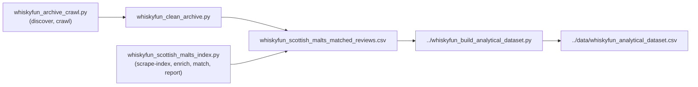

# `pipeline/`: Corpus Acquisition

This directory scrapes, cleans, and matches the raw Whiskyfun corpus into the
inputs consumed by `whiskyfun_build_analytical_dataset.py` at the repository
root. **It has already been run.** Its committed outputs are enough to
reproduce every published result; re-scraping is not required and not
expected.

## Pipeline stages

`whiskyfun_pilot_scraper.py` holds the page parser shared by the crawler and
the index scraper. `whiskyfun_parse_utils.py` holds title/score/multi-review
parsing helpers used by both `whiskyfun_clean_archive.py` and the pilot
scraper; it is covered by `test_whiskyfun_parse_utils.py`.
`whiskyfun_scottish_malts_normalize.py` normalizes names and URLs for the
index-to-corpus match step.

## What is tracked in git

| File | Role |
| --- | --- |
| `whiskyfun_archive_crawl.py`, `whiskyfun_clean_archive.py`, `whiskyfun_pilot_scraper.py`, `whiskyfun_parse_utils.py` | Crawl and clean scripts |
| `whiskyfun_scottish_malts_index.py`, `whiskyfun_scottish_malts_normalize.py` | Index scrape and corpus-match scripts |
| `test_whiskyfun_parse_utils.py`, `validate_whiskyfun_clean_sample.py` | Tests and a manual spot-check script |
| `bi_gram_list.txt` | Bigram candidate list consumed by `notebooks/w0_preproc_bigrams.ipynb` |
| `whiskyfun_scottish_malts_matched_reviews.csv` | **Build input.** Full corpus rows plus index-matching diagnostics; read by `../whiskyfun_build_analytical_dataset.py` |
| `whiskyfun_scottish_malts_index_pages.csv`, `whiskyfun_scottish_malts_index_metadata.csv` | Scottish Malts index metadata used in the match step |
| `whiskyfun_scottish_malts_matching_report.txt` | Human-readable summary of the index-to-corpus match run |
| `whiskyfun_index_scrape_log.jsonl` | Scrape event log for the index run |

## Raw crawl data (deleted)

The raw scrape cache (671 HTML pages) and the 167 monthly raw and cleaned
archive CSVs were never tracked by git and were deleted in the November 2026
cleanup, along with the smoke-test and match-diagnostic intermediates. Nothing
in the analysis reads them once `whiskyfun_scottish_malts_matched_reviews.csv`
exists. Regenerating them means re-crawling whiskyfun.com with
`whiskyfun_archive_crawl.py` and `whiskyfun_clean_archive.py` (see their
docstrings for CLI usage); the live site may have changed since the original
2026 crawl.

`test_whiskyfun_parse_utils.py` reads one fixture row from
`whiskyfun_archive_2012_2025/reviews_2017_04.csv` if present and self-skips
that single test otherwise, so the suite still runs without the raw archive.
